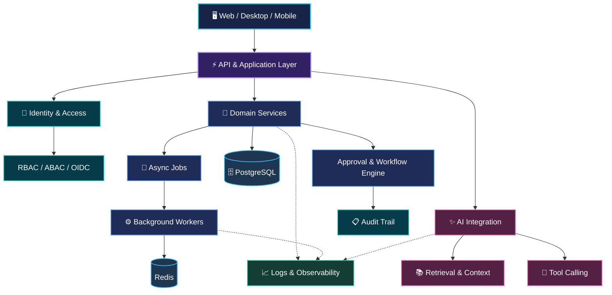
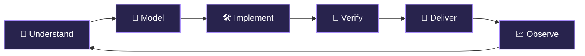

<!-- ========================================================= -->
<!-- PENGUY. | NEON ENGINEERING COMMAND CENTER                 -->
<!-- GitHub: https://github.com/kdy74                       -->
<!-- Theme: Midnight Navy / Electric Purple / Cyan / Rose     -->
<!-- ========================================================= -->

<div align="center">


<a href="https://github.com/kdy74">

</a>
<a href="mailto:duycaduoc0704@gmail.com">

</a>


<br/><br/>


<br/>

<b>ENGINEERING SOFTWARE FROM THE INTERFACE TO THE INFRASTRUCTURE.</b>

<br/><br/>


<br/><br/>

<a href="#about-me">About</a> &nbsp;•&nbsp;
<a href="#engineering-expertise">Expertise</a> &nbsp;•&nbsp;
<a href="#technology-stack">Tech Stack</a> &nbsp;•&nbsp;
<a href="#system-blueprint">Architecture</a> &nbsp;•&nbsp;
<a href="#engineering-philosophy">Philosophy</a> &nbsp;•&nbsp;
<a href="#github-activity">Activity</a>

</div>

---

<a id="about-me"></a>

## 🌌 About Me

<table>
<tr>
<td width="56%" valign="top">

### Hey, I'm penguy. 👋

I'm a **Full-Stack Software Engineer** based in Hanoi, Vietnam.

I design and build applications where **product engineering, system architecture, security and infrastructure** come together.

My work focuses on turning complicated business processes into reliable software: from intuitive interfaces and backend services to authorization, approval workflows, audit trails and AI-powered experiences.

I enjoy working across the entire software lifecycle — understanding requirements, designing architecture, writing code, testing behavior, deploying services and investigating production issues.

**What matters to me:**

- 🧩 Clear domain boundaries and maintainable architecture
- 🔐 Security and correctness built into the design
- ⚡ Fast, thoughtful and accessible product experiences
- 🔍 Observable systems with predictable failure behavior
- 🚀 Reliable delivery from development to production

</td>
<td width="44%" valign="top">

### 🖥️ Engineer Console

```yaml
identity:
  alias: "penguy."
  role: "Software Engineer"
  location: "Hanoi, Vietnam"
  timezone: "UTC+7"

primary_focus:
  - Full-Stack Engineering
  - Backend Architecture
  - Enterprise Platforms
  - AI-Native Applications

engineering:
  design: "Domain first"
  security: "By default"
  quality: "Automated"
  delivery: "Production minded"
```

</td>
</tr>
</table>

<div align="center">


</div>

<br/>

<a id="engineering-expertise"></a>

## ⚡ Engineering Expertise

**The areas where I turn technical complexity into working software.**

<table>
<tr>

<td width="50%" valign="top">

### 🧠 01. Systems Architecture

Designing backend systems that can evolve without becoming difficult to maintain.

- Domain-Driven Design
- Modular Monolith Architecture
- Clean Architecture and CQRS
- Event-Driven Processing
- Background Jobs and Queues
- API Contracts and Service Boundaries
- Database Design and Migrations


</td>

<td width="50%" valign="top">

### 🛡️ 02. Security & Enterprise

Building enterprise applications with explicit permissions, traceability and controlled business operations.

- Authentication and Authorization
- OAuth 2.0 / OpenID Connect
- Role-Based Access Control
- Attribute-Based Access Control
- Multi-Tenant Data Isolation
- Approval Workflow Engines
- Audit Logging and Traceability


</td>

</tr>

<tr>

<td width="50%" valign="top">

### ✨ 03. AI-Native Engineering

Exploring how AI can become a useful, dependable part of real software products.

- LLM Integration
- Retrieval-Augmented Generation
- Tool Calling and AI Agents
- Context and Prompt Engineering
- Structured AI Outputs
- AI Evaluation and Guardrails
- Human-in-the-Loop Experiences


</td>

<td width="50%" valign="top">

### 🎨 04. Product & Interface

Developing user experiences across web, desktop and mobile platforms.

- React and Next.js Applications
- Data-Intensive Dashboards
- Complex Forms and Workflows
- Component and Design Systems
- Desktop Applications with Tauri
- Cross-Platform Mobile with Flutter
- UI Performance and Accessibility


</td>

</tr>

<tr>

<td width="50%" valign="top">

### 🗄️ 05. Backend & Data

Creating reliable application services and data-processing workflows.

- REST API Development
- PostgreSQL Data Modeling
- Redis Caching and Coordination
- Asynchronous Processing
- BullMQ Job Queues
- Transactions and Concurrency
- Idempotency and Error Recovery


</td>

<td width="50%" valign="top">

### 🚀 06. Platform & Delivery

Making software easier to deploy, observe, operate and improve.

- Linux Server Administration
- Docker and Containerization
- Nginx and Reverse Proxies
- GitHub Actions and CI/CD
- Automated Quality Gates
- Monitoring, Logs and Health Checks
- Deployment and Rollback Strategies


</td>

</tr>
</table>

---

<a id="technology-stack"></a>

## 🪐 Technology Stack

**Languages, frameworks and tools I work with across different layers of software development.**

### 💎 Languages

<div align="center">

<br/>
<sub>TypeScript • JavaScript • Python • Rust • Java • Dart</sub>
</div>

<br/>

### 🎨 Frontend Engineering

<div align="center">

<br/>
<sub>React • Next.js • Tailwind CSS • Vite • Redux</sub>
</div>

<br/>

### ⚙️ Backend Engineering

<div align="center">

<br/>
<sub>Node.js • NestJS • Express • FastAPI • Prisma / TypeORM</sub>
</div>

<br/>

### 📱 Desktop & Mobile

<div align="center">

<br/>
<sub>Rust + Tauri • Flutter</sub>
</div>

<br/>

### 🗃️ Databases & Storage

<div align="center">

<br/>
<sub>PostgreSQL • Redis • MongoDB • MySQL</sub>
</div>

<br/>

### 🛠️ Infrastructure & Developer Tools

<div align="center">

<br/>
<sub>Docker • Nginx • Linux • GitHub Actions • Git • Jest • Figma</sub>
</div>

<br/>

<div align="center">

**ARCHITECTURE & ENGINEERING CONCEPTS**


</div>

---

<a id="system-blueprint"></a>

## 🏗️ System Blueprint

### How I think about a modern software platform

An illustrative reference architecture connecting product interfaces, enterprise security, business logic, asynchronous processing and AI capabilities.



<div align="center">


</div>

<br/>

### 🔍 The engineering problems I enjoy solving

| Area | Engineering challenges |
|:---|:---|
| 🔐 **Identity** | Who can perform which action, on which resource, under which conditions? |
| 🧩 **Domain** | How do complex business rules remain explicit and testable? |
| ⚙️ **Concurrency** | How do we prevent duplicated actions and invalid state transitions? |
| 📨 **Async processing** | How do we retry safely and make jobs recoverable? |
| 🗄️ **Data** | How do we preserve consistency while evolving the schema? |
| ✨ **AI** | How do we make model-driven behavior measurable and controllable? |
| 📈 **Operations** | How do we detect, understand and recover from production failures? |

---

## 🚧 Currently Building & Exploring

<table>
<tr>
<td width="50%" valign="top">

### 🏢 Enterprise Workspaces

**AI-native software for real organizational workflows.**

Working on systems involving:

- Approval and procurement flows
- Complex business state transitions
- Identity and permission models
- Audit and accountability
- Enterprise application architecture
- Operational reliability


</td>
<td width="50%" valign="top">

### 🧠 AI + Product Engineering

**From isolated AI capabilities to useful product experiences.**

Exploring:

- AI integration in business workflows
- Context-aware retrieval
- Tool-enabled applications
- Evaluation and guardrails
- Human review and intervention
- Practical AI interaction patterns


</td>
</tr>
<tr>
<td width="50%" valign="top">

### 🖥️ Cross-Platform Products

**One product vision, multiple environments.**

Interested in:

- Rich web interfaces
- Desktop-first experiences
- Local-first application design
- Rust and Tauri integration
- Flutter mobile development
- Shared domain contracts


</td>
<td width="50%" valign="top">

### 🛠️ Platform & Infrastructure

**Understanding what happens after the code is written.**

Deepening knowledge in:

- Linux administration
- Networking and HTTP infrastructure
- Service management
- Container deployment
- Monitoring and troubleshooting
- Backup, recovery and rollback


</td>
</tr>
</table>

---

<a id="engineering-philosophy"></a>

## 🎯 Engineering Philosophy

<div align="center">

### ✦ Design for change. Build for correctness. Operate with confidence.

</div>

<table>
<tr>
<td align="center" width="25%">
<h2>🧱</h2>
<b>ARCHITECTURE</b>
<br/>
<sub>Clear boundaries<br/>Explicit contracts<br/>Simple abstractions</sub>
</td>
<td align="center" width="25%">
<h2>🛡️</h2>
<b>SECURITY</b>
<br/>
<sub>Least privilege<br/>Safe defaults<br/>Auditable decisions</sub>
</td>
<td align="center" width="25%">
<h2>🧪</h2>
<b>QUALITY</b>
<br/>
<sub>Meaningful tests<br/>Automated checks<br/>Predictable releases</sub>
</td>
<td align="center" width="25%">
<h2>📡</h2>
<b>RELIABILITY</b>
<br/>
<sub>Useful telemetry<br/>Visible failures<br/>Recoverable systems</sub>
</td>
</tr>
</table>

### ⚙️ My development loop



<details>
<summary><b>🔬 What I value in a codebase — click to expand</b></summary>
<br/>

**Maintainability:** Code should communicate intent through meaningful names, focused modules and predictable contracts.

**Correctness:** Important business rules should be enforced in the domain and verified through tests, not scattered across controllers and UI components.

**Security:** Authentication, authorization, validation and auditing are architectural concerns, not final-stage additions.

**Reliability:** Background operations need idempotency, bounded retries, visibility and recovery paths.

**Delivery:** CI pipelines should provide real confidence. Every release should have a clear verification and rollback strategy.

**Pragmatism:** Use the simplest architecture that solves the problem, and introduce complexity when its benefits justify the cost.

</details>

---

<a id="github-activity"></a>

## 📊 GitHub Activity

<div align="center">

<picture>
<source media="(prefers-color-scheme: dark)" srcset="https://github-readme-activity-graph.vercel.app/graph?username=kdy74&amp;bg_color=0B1026&amp;color=C4B5FD&amp;line=22D3EE&amp;point=F472B6&amp;area=true&amp;area_color=8B5CF6&amp;hide_border=true&amp;custom_title=Engineering%20Activity" />

</picture>

<br/>

<picture>
<source media="(prefers-color-scheme: dark)" srcset="https://github-readme-stats.vercel.app/api?username=kdy74&amp;show_icons=true&amp;theme=tokyonight&amp;hide_border=true&amp;include_all_commits=true" />

</picture>

<br/>

<sub>These cards reflect GitHub-visible activity and may not represent work in private or organization repositories.</sub>

</div>

---

## 🌱 Beyond Writing Code

I believe good engineering involves more than knowing frameworks or shipping features.

It means understanding the business problem, choosing appropriate trade-offs, communicating decisions, respecting security boundaries and making systems understandable for the people who maintain them.

I'm especially interested in the intersection of **software architecture, developer experience, infrastructure and AI-assisted products**.

<div align="center">


</div>

---

## 💌 Let's Connect

<div align="center">

### Have an interesting engineering problem to discuss?

I'm happy to connect about **full-stack development, backend architecture, enterprise systems, platform engineering and AI products**.

<br/>

<a href="mailto:duycaduoc0704@gmail.com">

</a>

<a href="https://github.com/kdy74">

</a>

<br/><br/>

**Vietnamese** — Native &nbsp; | &nbsp; **English** — Professional Working

<br/><br/>


</div>
