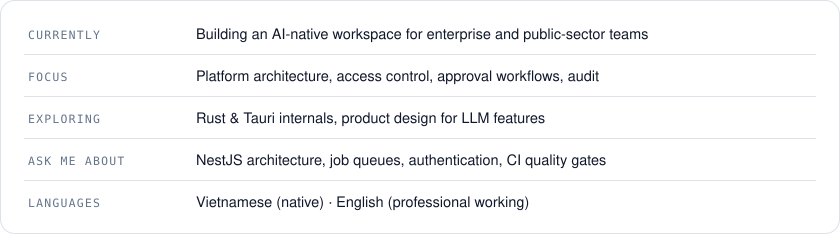
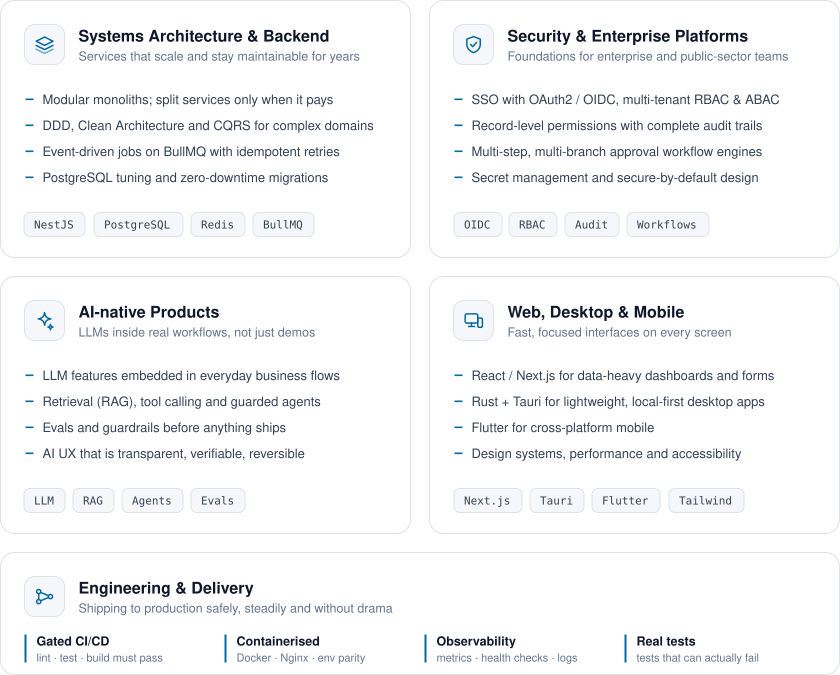
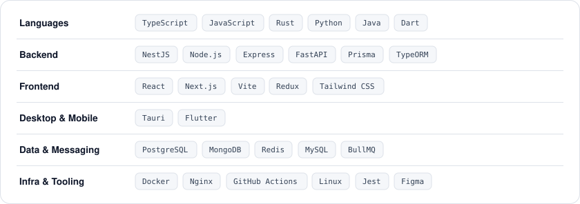
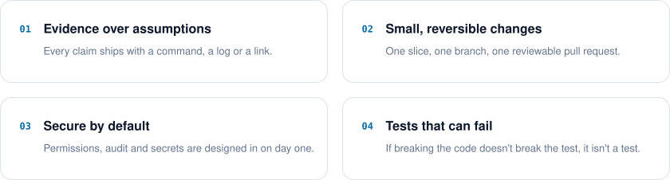

  <picture><source media="(prefers-color-scheme: dark)" srcset="https://raw.githubusercontent.com/kdy74/kdy74/main/assets/generated/hero-dark.bb8144473d.svg" /></picture>

  
  
  

 

<picture><source media="(prefers-color-scheme: dark)" srcset="https://raw.githubusercontent.com/kdy74/kdy74/main/assets/generated/section-1-dark.6458af567a.svg" /></picture>

I'm **penguy.**, a full-stack software engineer based in Hanoi. I work where product meets infrastructure: taking messy, real-world processes and turning them into systems that are **secure, observable and easy to change**.

Day to day I build an **AI-native workspace for enterprise and public-sector teams**: approval engines, access control and audit, plus the platform and developer tooling underneath. I care about clear domain models, boring and reliable infrastructure, and code the next engineer can pick up without a tour guide.

<picture><source media="(prefers-color-scheme: dark)" srcset="https://raw.githubusercontent.com/kdy74/kdy74/main/assets/generated/glance-dark.5531db2c8b.svg" /></picture>

 

<picture><source media="(prefers-color-scheme: dark)" srcset="https://raw.githubusercontent.com/kdy74/kdy74/main/assets/generated/section-2-dark.353a3b352d.svg" /></picture>

<picture><source media="(prefers-color-scheme: dark)" srcset="https://raw.githubusercontent.com/kdy74/kdy74/main/assets/generated/expertise-dark.a22888942f.svg" /></picture>

 

<picture><source media="(prefers-color-scheme: dark)" srcset="https://raw.githubusercontent.com/kdy74/kdy74/main/assets/generated/section-3-dark.098f23f9e6.svg" /></picture>

<picture><source media="(prefers-color-scheme: dark)" srcset="https://raw.githubusercontent.com/kdy74/kdy74/main/assets/generated/stack-dark.cd0f4b307d.svg" /></picture>

 

<picture><source media="(prefers-color-scheme: dark)" srcset="https://raw.githubusercontent.com/kdy74/kdy74/main/assets/generated/section-4-dark.e55d765bf5.svg" /></picture>

<picture><source media="(prefers-color-scheme: dark)" srcset="https://raw.githubusercontent.com/kdy74/kdy74/main/assets/generated/principles-dark.639aea0b16.svg" /></picture>

 

  <picture><source media="(prefers-color-scheme: dark)" srcset="https://raw.githubusercontent.com/kdy74/kdy74/main/assets/generated/footer-dark.7f6e5cdc41.svg" /></picture>

