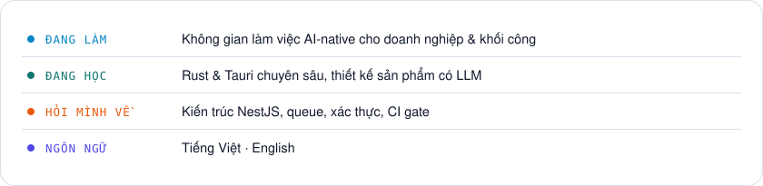
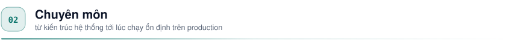
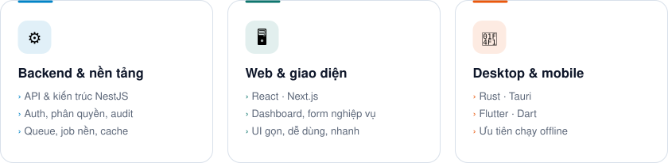
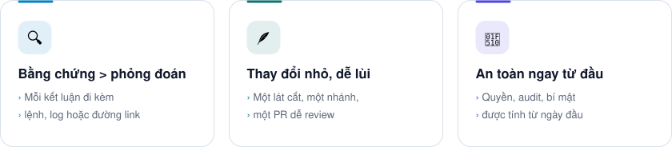

  <picture><source media="(prefers-color-scheme: dark)" srcset="https://raw.githubusercontent.com/kdy74/kdy74/main/assets/generated/hero-dark.svg?v=ea76b220e1" /></picture>

  
  
  

 

<picture><source media="(prefers-color-scheme: dark)" srcset="https://raw.githubusercontent.com/kdy74/kdy74/main/assets/generated/section-1-dark.svg?v=0c07b411b5" /></picture>

**Xin chào!** Mình là **penguy.** — một full-stack engineer ở Hà Nội. Mình thích nhận những quy trình rối rắm ngoài đời thực và biến chúng thành phần mềm **gọn gàng, ổn định và dễ tin cậy**.

Hằng ngày mình xây dựng **không gian làm việc AI-native** cho đội ngũ doanh nghiệp và khối công: luồng phê duyệt, nền tảng bảo mật và bộ công cụ cho lập trình viên xung quanh chúng. Ngoài giờ, mình làm những công cụ desktop nhỏ ưu tiên chạy offline.

<picture><source media="(prefers-color-scheme: dark)" srcset="https://raw.githubusercontent.com/kdy74/kdy74/main/assets/generated/now-dark.svg?v=35d2f4681f" /></picture>

<picture><source media="(prefers-color-scheme: dark)" srcset="https://raw.githubusercontent.com/kdy74/kdy74/main/assets/generated/section-2-dark.svg?v=78017f5f1c" /></picture>

<picture><source media="(prefers-color-scheme: dark)" srcset="https://raw.githubusercontent.com/kdy74/kdy74/main/assets/generated/what-dark.svg?v=b60009bb20" /></picture>

<picture><source media="(prefers-color-scheme: dark)" srcset="https://raw.githubusercontent.com/kdy74/kdy74/main/assets/generated/section-3-dark.svg?v=6b5f804424" /></picture>

<table>
  <tr>
    <td align="right" width="22%"><b>Ngôn ngữ</b></td>
    <td><picture><source media="(prefers-color-scheme: dark)" srcset="https://skillicons.dev/icons?i=ts,js,rust,python,java,dart&theme=dark" /></picture></td>
  </tr>
  <tr>
    <td align="right" width="22%"><b>Backend</b></td>
    <td><picture><source media="(prefers-color-scheme: dark)" srcset="https://skillicons.dev/icons?i=nestjs,nodejs,express,fastapi&theme=dark" /></picture></td>
  </tr>
  <tr>
    <td align="right" width="22%"><b>Frontend</b></td>
    <td><picture><source media="(prefers-color-scheme: dark)" srcset="https://skillicons.dev/icons?i=react,nextjs,vite,redux,tailwind&theme=dark" /></picture></td>
  </tr>
  <tr>
    <td align="right" width="22%"><b>Desktop · Mobile</b></td>
    <td><picture><source media="(prefers-color-scheme: dark)" srcset="https://skillicons.dev/icons?i=tauri,flutter&theme=dark" /></picture></td>
  </tr>
  <tr>
    <td align="right" width="22%"><b>Dữ liệu</b></td>
    <td><picture><source media="(prefers-color-scheme: dark)" srcset="https://skillicons.dev/icons?i=postgres,mongodb,redis,prisma,mysql&theme=dark" /></picture></td>
  </tr>
  <tr>
    <td align="right" width="22%"><b>Vận hành</b></td>
    <td><picture><source media="(prefers-color-scheme: dark)" srcset="https://skillicons.dev/icons?i=docker,nginx,githubactions,git,linux,figma&theme=dark" /></picture></td>
  </tr>
</table>

<picture><source media="(prefers-color-scheme: dark)" srcset="https://raw.githubusercontent.com/kdy74/kdy74/main/assets/generated/section-4-dark.svg?v=82864d53a3" /></picture>

<picture><source media="(prefers-color-scheme: dark)" srcset="https://raw.githubusercontent.com/kdy74/kdy74/main/assets/generated/principles-dark.svg?v=5f28b98e4c" /></picture>

 

  <picture><source media="(prefers-color-scheme: dark)" srcset="https://raw.githubusercontent.com/kdy74/kdy74/main/assets/generated/footer-dark.svg?v=b056b7a280" /></picture>

